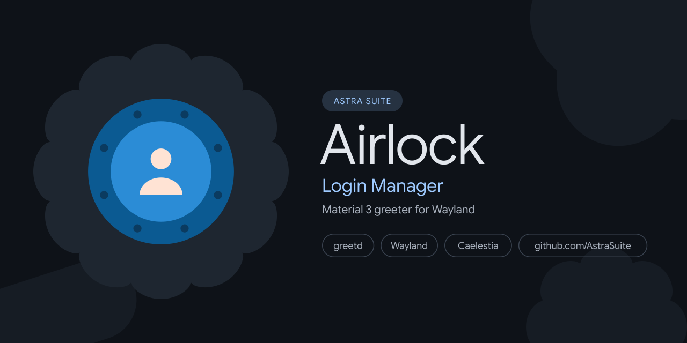

<p align="center">
  
</p>

# PermaFrost 🏔️

> Material 3 Display Manager Frontend for greetd

PermaFrost (also known as Airlock) is a modern, fluid Material 3 display manager frontend for **[greetd](https://git.sr.ht/~kennylevinsen/greetd)**, crafted with **[Quickshell](https://quickshell.outfoxxed.me/)** and Qt6 to integrate with Caelestia environments.

> [!TIP]
> **Complete Documentation:** Comprehensive configuration guides, multi-monitor recipes, PAM auto-unlock instructions, and development workflows are available on the **[PermaFrost Documentation Site](https://spanishsyntax.github.io/PermaFrost)**.

---

## Why "PermaFrost" & "Airlock"? (The Lore)

> **permafrost** (`/ˈpɜː.mə.frɒst/`) — *noun:* Ground that remains completely frozen beneath the arctic surface for consecutive years, providing an impervious, solid foundation for polar habitats.
>
> **airlock** (`/ˈeə.lɒk/`) — *noun:* The pressurized, sealed transit chamber that bridges harsh subzero blizzards outside with the warm, breathable environment within.

In polar architecture, you never step directly from a -40°C arctic blizzard into your living quarters without passing through an airlock that stabilizes pressure, keeps out drift snow, and verifies identity.

**Airlock safeguards the boundary of your desktop:**
- **The Threshold Chamber**: A modern, fluid Material 3 greetd login frontend crafted with Quickshell and Qt6 that greets you at system boot.
- **Impervious Foundation**: Rests directly atop the system's NixOS foundation, ensuring secure credential handling, smooth PAM authentication, and instant desktop session transitions.

---

## Features

- **Material 3 Expressive UI**: Dynamic typography clocks, responsive layout scaling, and fluid state layers.
- **Dynamic Theme Synchronization**: Automatically mirrors your active Caelestia desktop palette (`dark.json` / `light.json`) into the login screen.
- **Wayland Native**: Optimized for lightweight kiosk compositors: **Cage** (minimal kiosk) or **Hyprland** (hardware-accelerated compositor).
- **Multi-Monitor Geometry**: Native integration with the `wlr-output-management` protocol via `wlr-randr`, including automatic translation of existing Hyprland monitor layouts.
- **State Persistence**: Saves UI preferences, color schemes, avatar formats, and last-selected session per user in `/var/cache/astra-airlock/greeter.json`.
- **NixOS Module**: Built-in NixOS Flake module (`services.greetd.astraAirlock`) managing dependencies, tmpfiles, and startup commands.

---

## Dependencies

### Runtime
- **[greetd](https://git.sr.ht/~kennylevinsen/greetd)**
- **[Quickshell](https://quickshell.outfoxxed.me/)** $\ge$ 0.3.0
- **Qt 6.6+** (Core, DBus, Qml, Quick, Quick3D)
- **M3Shapes QML module** (provided by Caelestia Shell or upstream m3shapes)
- **Wayland Compositor**: [Cage](https://github.com/cage-kiosk/cage) or [Hyprland](https://github.com/hyprwm/hyprland)

### Build
- **CMake** $\ge$ 3.19
- **Ninja**

### Optional
- **[caelestia-cli](https://github.com/caelestia-dots/cli)** — Required for desktop theme synchronization via `--sync`
- **[wlr-randr](https://gitlab.freedesktop.org/emersion/wlr-randr)** — Required when specifying custom monitor layout flags

---

## Installation

### Arch Linux (AUR)

Install via your preferred AUR helper:

```bash
# Stable release
paru -S astra-airlock

# Latest development branch
paru -S astra-airlock-git
```

### Manual Compilation (CMake)

```bash
# Clone and build
git clone https://github.com/SpanishSyntax/PermaFrost.git ~/PermaFrost
cd ~/PermaFrost
cmake -B build -G Ninja -DCMAKE_BUILD_TYPE=Release
cmake --build build

# Install binaries and configuration
sudo cmake --install build
```

### NixOS Flake Configuration

```nix
{
  inputs = {
    nixpkgs.url = "github:nixos/nixpkgs/nixos-unstable";
    permafrost.url = "github:SpanishSyntax/PermaFrost";
  };

  outputs = { self, nixpkgs, permafrost, ... }: {
    nixosConfigurations.workstation = nixpkgs.lib.nixosSystem {
      system = "x86_64-linux";
      modules = [
        permafrost.nixosModules.default
        {
          services.greetd.astraAirlock = {
            enable = true;
            compositor = "cage"; # "cage" or "hyprland"
          };
        }
      ];
    };
  };
}
```

---

## Setting Up with greetd

### 1. Greeter User and Cache Directory

On non-Nix installations, create the system `greeter` user and shared cache directory:

```bash
getent passwd greeter >/dev/null || \
    sudo useradd -r -M -s /usr/bin/nologin -d /var/cache/astra-airlock greeter

sudo usermod -aG video,input greeter
sudo install -d -m 0755 -o greeter -g greeter /var/cache/astra-airlock
```

### 2. User Profile Pictures

Because `greetd` runs under the restricted system user, it cannot read images from user home directories:

```bash
sudo astra-airlock --set-pfp /path/to/avatar.png
```

### 3. Kiosk Configuration (Cage and Hyprland)

Generate the greetd configuration using the automated `--kiosk` command:

```bash
# Deploy Cage configuration to /etc/greetd/config.toml
sudo astra-airlock --kiosk cage

# Or deploy Hyprland configuration
sudo astra-airlock --kiosk hyprland
```

### 4. PAM Configuration & Keyring Auto-Unlock

Ensure `/etc/pam.d/greetd` includes `pam_gnome_keyring.so`:

```text
# /etc/pam.d/greetd
#%PAM-1.0

auth       required     pam_securetty.so
auth       requisite    pam_nologin.so
auth       include      system-local-login
auth       optional     pam_gnome_keyring.so

account    include      system-local-login

password   include      system-local-login

session    include      system-local-login
session    optional     pam_gnome_keyring.so auto_start
```

### 5. Multi-Monitor Management

Pass display flags inside the `command` string in `/etc/greetd/config.toml`:

```toml
# Display only on DP-2
command = "cage -s -- astra-airlock --only DP-2"

# Explicit layout with custom refresh rate and scaling
command = "cage -s -- astra-airlock --output DP-1 --mode 2560x1440@144 --pos 0,0 --scale 1 --output HDMI-A-1 --off"
```

Translate existing Hyprland layouts automatically:

```bash
astra-airlock --convert ~/.config/hypr/monitors.conf
```

### 6. Desktop Theme Synchronization

Sync your active Caelestia desktop palette to the login greeter:

```bash
sudo astra-airlock --sync
```

For automatic synchronization on theme or wallpaper changes, configure passwordless sudoers access:

```text
# /etc/sudoers.d/astra-airlock-sync
your-username ALL=(ALL) NOPASSWD: /usr/bin/astra-airlock -s, /usr/bin/astra-airlock --sync
```

Add hooks in `~/.config/caelestia/cli.json`:

```json
{
  "theme": {
    "postHook": "sudo -n astra-airlock --sync"
  },
  "wallpaper": {
    "postHook": "sudo -n astra-airlock --sync"
  }
}
```

### 7. Enabling the Service

```bash
# Disable existing display manager
sudo systemctl disable sddm.service

# Enable greetd
sudo systemctl enable --now greetd.service
```

---

## Testing & Local Development

Test the greeter UI without logging out of your active session:

```bash
cmake -B build -G Ninja
cmake --build build

QML2_IMPORT_PATH=./build/qml quickshell -p .
```

---

## Credits & License

PermaFrost incorporates components and design tokens from **[Caelestia Shell](https://github.com/caelestia-dots/shell)** (M3Shapes, LoadingIndicator, Clock styling, and typography assets).

Licensed under [GPL v3](LICENSE).
