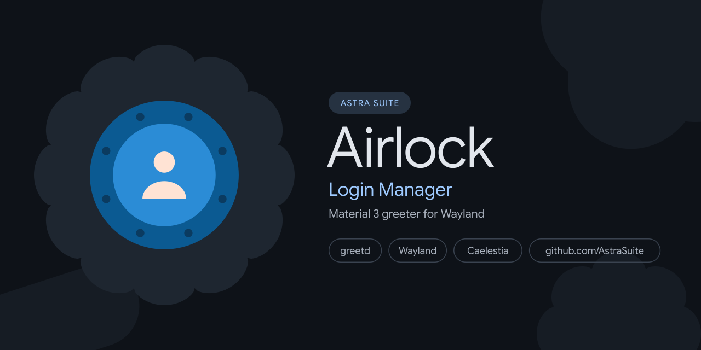

  

# PermaFrost 🏔️

A modern, fluid Material 3 display manager frontend for **[greetd](https://git.sr.ht/~kennylevinsen/greetd)**, crafted with **[Quickshell](https://quickshell.outfoxxed.me/)** and Qt6 to seamlessly integrate with Caelestia environments.

PermaFrost (also known as Airlock) provides declarative multi-monitor geometry management, PAM session authentication with automatic keyring unlocking, dynamic Material 3 desktop theme synchronization, and smooth session handoffs.

> [!TIP]
> **Complete Documentation:** Step-by-step setup guides, NixOS Flake modules, multi-monitor configuration flags, and development workflows are available on the **[Documentation Site](https://spanishsyntax.github.io/PermaFrost)**.

---

## Why "PermaFrost" & "Airlock"? (The Lore)

> **permafrost** (`/ˈpɜː.mə.frɒst/`) — *noun:* Ground that remains completely frozen beneath the arctic surface for consecutive years, providing an impervious, solid foundation for polar habitats.
>
> **airlock** (`/ˈeə.lɒk/`) — *noun:* The pressurized, sealed transit chamber that bridges harsh subzero blizzards outside with the warm, breathable environment within.

In polar architecture, you never step directly from a -40°C arctic blizzard into your living quarters without passing through an airlock that stabilizes pressure, keeps out drift snow, and verifies identity.

**Airlock safeguards the boundary of your desktop:**
- **The Threshold Chamber**: A modern, fluid Material 3 greetd login frontend crafted with Quickshell and Qt6 that greets you at system boot.
- **Impervious Foundation**: Rests directly atop the system's NixOS foundation, ensuring secure credential handling, smooth PAM authentication, and instant desktop session transitions.

---

## Key Features

- **Material 3 Expressive UI**: Morphing clock animations, smooth avatar transitions, fluid state layers, and high-performance Qt Quick 3D visuals.
- **Dynamic Theme Synchronization (`--sync`)**: Automatically extracts the active user's Caelestia desktop palette (`dark.json` and `light.json`) into `/var/cache/astra-airlock/` and dynamically switches themes upon user selection.
- **Wayland Native**: Optimized for lightweight Wayland kiosk compositors: **Cage** (minimal kiosk) or **Hyprland** (hardware-accelerated compositor).
- **Multi-Monitor Management**: Built-in integration with the `wlr-output-management` protocol via `wlr-randr`, including automatic conversion of Hyprland monitor layouts.
- **Persistent Greeter State**: Preserves user preferences (avatar shape, 12/24h time, idle animations, color schemes, and last-used session) across boots via `/var/cache/astra-airlock/greeter.json`.
- **Nix-Native**: First-class Flake output providing the `astra-airlock` package, development shell, and `services.greetd.astraAirlock` NixOS service module.

---

## Table of Contents

- [Getting Started](getting-started.md)
  - [Installation (Arch Linux / CMake / NixOS)](getting-started.md#installation)
  - [Nix & NixOS Setup](getting-started.md#nix--nixos-setup)
  - [Quick Start Guide](getting-started.md#quick-start)
- [Architecture & Foundations](architecture.md)
  - [The Lore](architecture.md#why-permafrost--airlock-the-lore)
  - [Component Architecture](architecture.md#component-architecture)
  - [Quickshell & Qt6 Pipeline](architecture.md#quickshell--qt6-rendering-pipeline)
  - [PAM & Session Handshake](architecture.md#pam-authentication--session-handshake)
- [Configuration Reference](configuration.md)
  - [NixOS Module Reference](configuration.md#nixos-module-options)
  - [greetd Configuration](configuration.md#greetd-configuration)
  - [Hyprland Kiosk Setup](configuration.md#hyprland-kiosk-configuration)
  - [Cage Kiosk Setup](configuration.md#cage-kiosk-configuration)
  - [PAM Keyring Auto-Unlock](configuration.md#pam-configuration--keyring-auto-unlock)
- [CLI & Operations](usage.md)
  - [CLI Flag Reference](usage.md#cli-flag-reference)
  - [Multi-Monitor Configuration](usage.md#multi-monitor-management)
  - [Converting Hyprland Monitors](usage.md#converting-hyprland-monitor-layouts)
  - [Desktop Theme Sync](usage.md#syncing-active-desktop-themes)
  - [Local Development & Testing](usage.md#testing--local-development)
