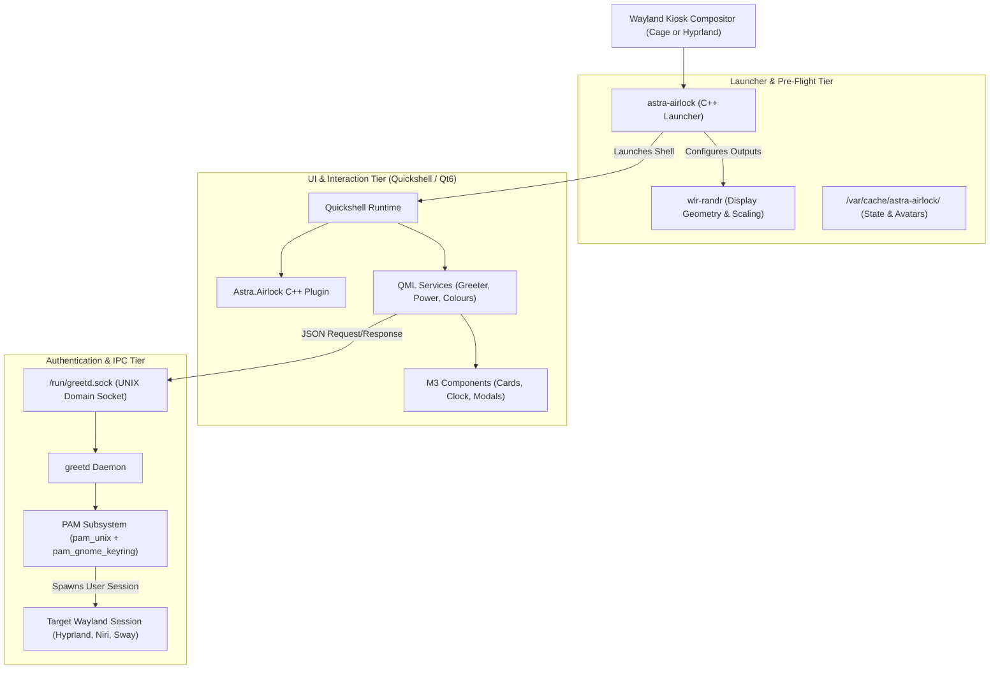

# Architecture & Foundations

PermaFrost (Airlock) is structured as a decoupled Wayland display manager frontend. It bridges the low-level Linux authentication layer with hardware-accelerated declarative Qt Quick / Quickshell user interfaces.

---

## Why "PermaFrost" & "Airlock"? (The Lore)

> **permafrost** (`/ˈpɜː.mə.frɒst/`) — *noun:* Ground that remains completely frozen beneath the arctic surface for consecutive years, providing an impervious, solid foundation for polar habitats.
>
> **airlock** (`/ˈeə.lɒk/`) — *noun:* The pressurized, sealed transit chamber that bridges harsh subzero blizzards outside with the warm, breathable environment within.

In polar architecture, you never step directly from a -40°C arctic blizzard into your living quarters without passing through an airlock that stabilizes pressure, keeps out drift snow, and verifies identity.

**Airlock safeguards the boundary of your desktop:**
- **The Threshold Chamber**: A modern, fluid Material 3 greetd login frontend crafted with Quickshell and Qt6 that greets you at system boot.
- **Impervious Foundation**: Rests directly atop the system's NixOS foundation, ensuring secure credential handling, smooth PAM authentication, and instant desktop session transitions.

---

## System Architecture

PermaFrost is split into three coordinated architectural tiers:



---

## Component Breakdown

### 1. The C++ Launcher (`launcher/main.cpp`)

The native binary acts as an orchestration entry point before the QML engine initializes:
- **Geometry Setup**: Parses command-line flags (`--output`, `--mode`, `--pos`, `--scale`), connects to the Wayland server, and applies output modes via `wlr-output-management` through `wlr-randr`.
- **Administrative Utilities**: Handles profile picture ingestion (`--set-pfp`), wallpaper installation (`--set-wallpaper`), Hyprland monitor syntax translation (`--convert`), and desktop color synchronization (`--sync`).
- **Kiosk Configuration Deployer**: Generates drop-in configurations for Cage or Hyprland (`--kiosk`).

### 2. The Native QML Plugin (`plugin/`)

A compiled C++ Qt6 plugin registered under the URI `Astra.Airlock`. It exposes high-performance primitives to the QML runtime:
- Native process execution and IPC wrappers.
- File system watchers and avatar caching helpers.
- Low-overhead system telemetry hooks (battery levels via sysfs, UPower, and DBus).

### 3. Services Layer (`services/`)

Decoupled singleton QML components coordinating application state:
- **`Greeter.qml`**: Implements the greetd client protocol over `/run/greetd.sock`. Handles session discovery (`.desktop` and Wayland session files in `/usr/share/wayland-sessions/`), user listing via `/etc/passwd`, and JSON-based PAM question/response transactions.
- **`Colours.qml`**: Dynamic Material 3 color harmonizer. Automatically falls back between built-in M3 palettes and user-synced desktop themes.
- **`SystemInfo.qml` & `BatteryState.qml`**: Telemetry collectors polling DBus and UPower for battery percentage, charging state, AC presence, and hostname.
- **`SystemPower.qml`**: Interface to logind/systemd for shutdown, reboot, suspend, and hibernate actions.

### 4. Components Layer (`components/`)

Over 35 atomic Material 3 widgets:
- `ActiveClock.qml`, `IdleClock.qml`, `LocklikeClock.qml`: Fluid typographic clocks with smooth morphing font weights.
- `PasswordInput.qml` & `InputField.qml`: Secure password input fields with caps-lock warning, visibility toggle, and error vibration states.
- `Avatar.qml`: Dynamic user avatar with configurable M3 squircle/circle clipping masks.
- `SessionPicker.qml`: Dropdown menu for selecting between available Wayland desktop sessions.
- `LavaLamp.qml`: Morphing organic background shape canvas powered by Qt Quick 3D.

---

## Authentication Handshake & PAM Lifecycle

Communication with `greetd` strictly adheres to its JSON IPC protocol:

```text
[Greeter.qml]                       [greetd Daemon]                  [PAM]
      |                                    |                           |
      |--- {"type": "create_session"} ---->|                           |
      |<-- {"type": "auth_message", ...} --|                           |
      |                                    |--- pam_authenticate() --->|
      |--- {"type": "post_auth_message_response",                      |
      |     "response": "<password>"} ---->|                           |
      |                                    |<-- PAM_SUCCESS -----------|
      |<-- {"type": "success"} ------------|                           |
      |--- {"type": "start_session",       |                           |
      |     "cmd": ["Hyprland"]} --------->|                           |
      |                                    |--- pam_open_session() --->|
      |                                    |--- execv(session_cmd) ---> User Session Started
```

If PAM prompts for additional authentication (e.g. multi-factor authentication, YubiKey touch, or password change), `Greeter.qml` receives the request dynamically and renders the appropriate challenge field without session termination.

---

## Cache & State Lifecycle

PermaFrost stores persistent preferences in `/var/cache/astra-airlock/`:

```text
/var/cache/astra-airlock/
├── greeter.json            # Active UI settings (clock mode, theme, last session)
├── avatars/
│   └── <username>          # Ingested profile pictures readable by 'greeter' user
└── schemes/
    └── dynamic/
        └── <username>/     # Synced Caelestia desktop themes (dark.json, light.json)
```

By persisting this state outside user home directories, the login screen seamlessly restores each user's chosen color scheme, avatar, and preferred desktop compositor the moment their username is highlighted.
